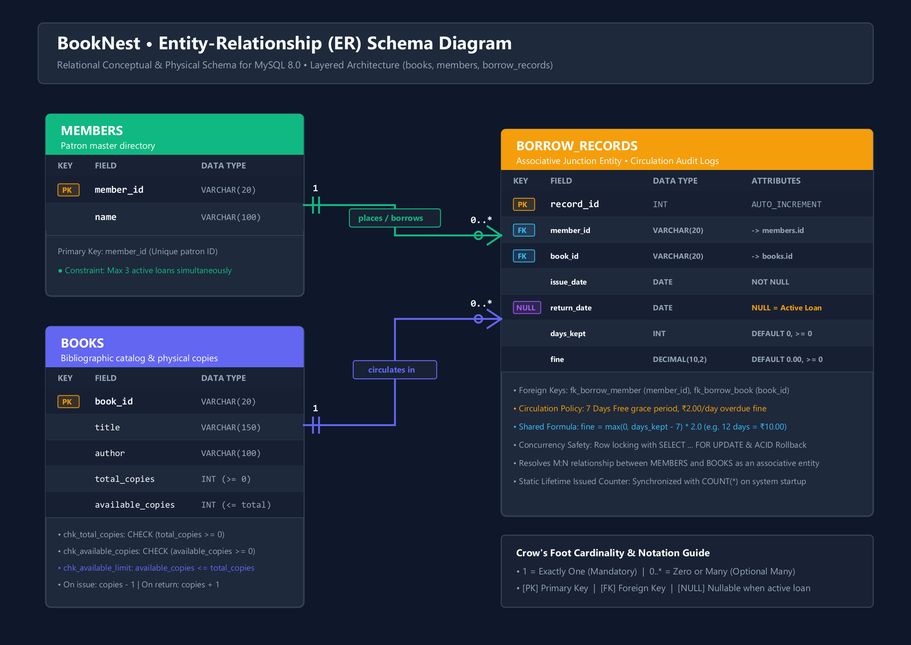

# 📖 BookNest – Library Management System

A robust, full-featured Library Management System developed using **Java**, **Object-Oriented Programming (OOP)**, **JDBC**, **MySQL 8.0**, and **Java Swing**. BookNest provides an automated solution for managing library book collections, patron memberships, and circulation workflows with automated fine assessment, strict concurrency protection, and real-time inventory tracking.

BookNest supports both a **modern custom-themed desktop GUI** (Java Swing Slate Theme) and an **interactive console interface (CLI)**.

---

## 🏛️ Architecture & Layered Design

BookNest follows the industry-standard **Layered Architecture** adhering to Separation of Concerns (SoC) and clean object-oriented design:

```
+-----------------------------------------------------------------------------------+
|                                Presentation Layer                                 |
|         Desktop Swing GUI (BookNestGUI.java)  /  Console CLI (Main.java)          |
+-----------------------------------------------------------------------------------+
                                         │
                                         ▼
+-----------------------------------------------------------------------------------+
|                                   Service Layer                                   |
|                               (LibraryService.java)                               |
|   • Enforces 3-Active-Loan Limit Rule      • Concurrency Row-Locking (FOR UPDATE) |
|   • Standardized Fine Calculation Logic    • Java Static Lifetime Issued Counter  |
|   • Overloaded Book Search Operations      • Atomic ACID Transaction Management   |
+-----------------------------------------------------------------------------------+
                                         │
                                         ▼
+-----------------------------------------------------------------------------------+
|                              Data Access Layer (DAO)                              |
|                   (BookDAO.java, MemberDAO.java, BorrowDAO.java)                  |
|   • Parameterized SQL PreparedStatement    • Prevents SQL Injection Vulnerability |
|   • CRUD Operations & Table Aggregations   • Referential Integrity Checks         |
+-----------------------------------------------------------------------------------+
                                         │
                                         ▼
+-----------------------------------------------------------------------------------+
|                                  Database Layer                                   |
|                (Database_connection.java -> MySQL 8.0 Database)                  |
|   • Secure Credential Loading (db.properties / Environment Variables)            |
+-----------------------------------------------------------------------------------+
```

---

## ☕ Java OOP Concepts Demonstrated

This project is structured specifically to showcase foundational and advanced Object-Oriented Programming concepts in Java:

| OOP Concept | Project Implementation Details |
| :--- | :--- |
| **Classes & Objects** | Concrete entity classes: [`Book`](file:///c:/Users/guru2/OneDrive/Desktop/library_management_jvdb/src/Book.java), [`Member`](file:///c:/Users/guru2/OneDrive/Desktop/library_management_jvdb/src/Member.java), [`BorrowRecord`](file:///c:/Users/guru2/OneDrive/Desktop/library_management_jvdb/src/BorrowRecord.java), and [`BorrowRecordDetail`](file:///c:/Users/guru2/OneDrive/Desktop/library_management_jvdb/src/BorrowRecordDetail.java) instantiate tangible library objects. |
| **Encapsulation** | All entity fields (`bookId`, `totalCopies`, `name`, `fine`, etc.) are declared `private`. Access and mutation are mediated strictly via public getters and setters with validation rules. |
| **Constructors** | Parameterized constructors ensure valid object instantiation in a single atomic step without leaving objects in an uninitialized state. |
| **Static Members** | 1. **Static Field Counter (`LibraryService.totalLifetimeIssued`):** A class-level static counter that tracks total books issued across the system lifetime. Increments strictly upon successful commit of an issue transaction.<br/>2. **Static Utility Methods:** `LibraryService.calculateFine(int daysKept)` and `LibraryService.calculateDaysKept(LocalDate, LocalDate)` provide a single, shared calculation engine used across the GUI, service layer, and unit tests. |
| **Method Overloading (Polymorphism)** | Demonstrated in [`LibraryService`](file:///c:/Users/guru2/OneDrive/Desktop/library_management_jvdb/src/LibraryService.java) and [`BookDAO`](file:///c:/Users/guru2/OneDrive/Desktop/library_management_jvdb/src/BookDAO.java):<br/>• `searchBook(String bookId)`: Exact ID lookup returning a single `Book`.<br/>• `searchBooks(String query)`: Unified multi-field search across ID, Title, and Author.<br/>• `searchBooks(String keyword, boolean searchByTitle)`: Boolean-flag overload searching specifically by title or author. |
| **Object Interaction** | Seamless collaboration where `LibraryService` coordinates between `Book`, `Member`, `BorrowRecord`, and their respective DAOs during issue and return transactions. |
| **Inheritance & Custom Components** | Demonstrated in [`UITheme`](file:///c:/Users/guru2/OneDrive/Desktop/library_management_jvdb/src/UITheme.java) and [`BookNestGUI`](file:///c:/Users/guru2/OneDrive/Desktop/library_management_jvdb/src/BookNestGUI.java) where custom UI elements extend `JPanel`, `JButton`, `JTextField`, and `JFrame`. |

---

## ✨ Key Features & Business Rules

### 📚 1. Book Management
- **Add New Book:** Registers book ID, title, author, total copies, and available copies.
- **Strict Validation:** Rejects empty fields, non-positive copy counts, and available copies exceeding total copies.
- **Duplicate ID Prevention:** Blocks duplicate primary keys with friendly, descriptive error messages.
- **Multi-Field Book Search:** Search instantly by Book ID, Title keyword, or Author keyword.
- **Safe Book Deletion:** Prevents deletion if active loans or historical borrowing records reference the title.

### 👥 2. Member Management
- **Register Member:** Stores unique Member ID and patron name.
- **Duplicate Member Prevention:** Prevents duplicate primary keys.
- **Search & Filter:** Instant live filtering of registered members by name or card ID.
- **Safe Deletion:** Rejects deletion if a member currently holds unreturned books or has past borrowing history.

### 🔄 3. Book Issuing (Circulation Rules)
- **Quota Enforcement:** **A member is strictly restricted to a maximum of 3 active loans** (`return_date IS NULL`). Fourth loan attempts are rejected immediately with transaction rollback.
- **Stock Verification:** Confirms at least 1 copy is available before issuing.
- **Concurrency Protection:** Uses MySQL row-locking (`SELECT ... FOR UPDATE`) within ACID transactions (`setAutoCommit(false)`, `commit()`, `rollback()`) to prevent race conditions on the last available copy.
- **Automatic Inventory Deduction:** Decrements `available_copies` by exactly 1 upon checkout.
- **Static Counter Tracking:** Increments the lifetime issued static counter strictly after transaction commit.

### 📥 4. Book Returns & Fine Assessment
- **Inclusive Days Kept Calculation:** Calculates elapsed loan duration inclusively (Day of issue counts as Day 1).
- **Standardized Fine Policy:**
  - **Grace Period:** 7 days free of charge.
  - **Overdue Penalty:** ₹2.00 per day charged for each day beyond day 7.
  - **Formula:** `fine = max(0, daysKept - 7) * 2.0`
  - *Example 1:* If daysKept = 7 $\rightarrow$ fine = ₹0.00.
  - *Example 2:* If daysKept = 12 $\rightarrow$ fine = $(12 - 7) \times ₹2.00 = ₹10.00$.
- **Automatic Restocking:** Increases `available_copies` by exactly 1 upon return.
- **Duplicate Return Prevention:** Rejects attempts to return already returned or nonexistent records.

### 📊 5. Real-Time Dashboard & Health Status
- **5 Live Stat Cards:** Total Titles, Shelf Copies, Active Patrons, Active Loans, and **Lifetime Issued (Static Counter)**.
- **Dynamic Database Status Indicator:** Real-time indicator in the sidebar displaying actual MySQL connection state (Connected / Disconnected) rather than a hardcoded label.
- **Audit History:** Filterable transaction logs with status badges (Active Loan vs. Returned).

---

## 🗄️ Database Schema & Entity-Relationship (ER) Diagram

The system uses three primary tables in the `booknest` MySQL database:

1. **`books`:** Bibliographic metadata and copy counts (`book_id` PK, `title`, `author`, `total_copies`, `available_copies`).
2. **`members`:** Patron records (`member_id` PK, `name`).
3. **`borrow_records`:** Associative junction table resolving the Many-to-Many relationship between members and books (`record_id` PK AUTO_INCREMENT, `member_id` FK, `book_id` FK, `issue_date`, `return_date`, `days_kept`, `fine`).

### Entity-Relationship Diagram:



> **ER Diagram Deliverables in Version Control:**
> - High-Resolution Image: [docs/ER_Diagram.png](file:///c:/Users/guru2/OneDrive/Desktop/library_management_jvdb/docs/ER_Diagram.png) (2400x1700 Retina 300 DPI)
> - Scalable Vector Version: [docs/ER_Diagram.svg](file:///c:/Users/guru2/OneDrive/Desktop/library_management_jvdb/docs/ER_Diagram.svg)
> - Mermaid Source Code: [docs/ER_Diagram.mmd](file:///c:/Users/guru2/OneDrive/Desktop/library_management_jvdb/docs/ER_Diagram.mmd)
> - Detailed Entity Documentation: [docs/ER_Diagram.md](file:///c:/Users/guru2/OneDrive/Desktop/library_management_jvdb/docs/ER_Diagram.md)

---

## 📂 Project Directory Structure

```text
library_management_jvdb/
│
├── .gitignore                      # Excludes .class, .env, and local db.properties
├── db.properties.example           # Safe configuration template with placeholders
├── db.properties                   # Local database credentials (Git ignored)
│
├── database/
│   ├── booknest.sql                # Production MySQL DDL schema and integrity constraints
│   └── seed_data.sql               # Rich demo dataset (books, members, loans)
│
├── docs/                           # Project documentation & ER diagram deliverables
│   ├── ER_Diagram.png              # High-resolution 300 DPI rendered ER diagram
│   ├── ER_Diagram.svg              # Scalable vector ER diagram
│   ├── ER_Diagram.mmd              # Editable Mermaid source code
│   └── ER_Diagram.md               # Detailed schema entity & cardinality documentation
│
├── lib/
│   └── mysql-connector-j-26.7.0.jar# Official MySQL Connector/J JDBC Driver
│
├── out/                            # Compiled Java bytecode (.class files)
│
├── src/                            # Production Java source code
│   ├── Main.java                   # Application launcher (GUI & Console CLI modes)
│   ├── BookNestGUI.java            # Desktop Java Swing user interface
│   ├── UITheme.java                # Modern custom UI design system & components
│   ├── Book.java                   # Book entity model (Encapsulated)
│   ├── Member.java                 # Member entity model (Encapsulated)
│   ├── BorrowRecord.java           # BorrowRecord entity model
│   ├── BorrowRecordDetail.java     # Enriched DTO for presentation
│   ├── BookDAO.java                # Data Access Object for books (Overloaded searches)
│   ├── MemberDAO.java              # Data Access Object for members
│   ├── BorrowDAO.java              # Data Access Object for borrowing records
│   ├── LibraryService.java         # Service layer (Transactions, Fines, Static Counter)
│   ├── Database_connection.java    # Central secure JDBC connection manager
│   └── DatabaseSeeder.java         # Non-destructive database seeder utility
│
├── test/                           # Comprehensive test suite
│   ├── TestBusinessLogic.java      # Pure unit tests (Fines, days kept, validation - No DB needed)
│   ├── TestIntegrationSuite.java   # Full MySQL integration test suite (ACID, 3-loan limit, returns)
│   ├── TestConnection.java         # Standalone connectivity test
│   ├── TestBookDAO.java            # Book DAO validation test
│   ├── TestMemberDAO.java          # Member DAO validation test
│   ├── TestBorrowDAO.java          # Borrow DAO validation test
│   ├── TestReturnBook.java         # Return book validation test
│   ├── TestLibraryService.java     # Service workflow test
│   ├── TestGUIStartup.java         # Headless GUI construction & layout verification test
│   └── GenerateERDiagramPNG.java   # Vector-to-PNG diagram renderer utility
│
└── README.md                       # Comprehensive project documentation
```

---

## ⚙️ Software Prerequisites

1. **Java Development Kit (JDK):**
   - JDK 17, 21, or higher (Tested and verified with **JDK 26**).
   - Verify with: `java -version` and `javac -version`.
2. **MySQL Server:**
   - MySQL Community Server 8.0 or higher running on `localhost:3306`.
3. **Operating System & Shell:**
   - Windows 10/11 with Windows PowerShell or Command Prompt.

---

## 🔒 Safe Database Configuration

BookNest prioritizes security and never commits plain-text database credentials to Git history:

1. Copy the configuration template:
   ```powershell
   Copy-Item db.properties.example db.properties
   ```
2. Edit `db.properties` with your local MySQL credentials:
   ```properties
   db.url=jdbc:mysql://localhost:3306/booknest
   db.user=root
   db.password=your_mysql_password
   ```
3. Alternatively, you can configure credentials using Windows PowerShell environment variables:
   ```powershell
   $env:BOOKNEST_DB_URL = "jdbc:mysql://localhost:3306/booknest"
   $env:BOOKNEST_DB_USER = "root"
   $env:BOOKNEST_DB_PASSWORD = "your_mysql_password"
   ```
> `db.properties` is registered in `.gitignore` and is automatically excluded from version control.

---

## 🗄️ MySQL Database Setup

1. Open Windows PowerShell or MySQL Command Line Client.
2. Execute the schema DDL script to create the database, tables, and constraints:
   ```powershell
   Get-Content database\booknest.sql | mysql -u root -p
   ```
3. *(Optional)* Populate initial sample data (Safe non-destructive insert):
   ```powershell
   java -cp "out;lib\*" DatabaseSeeder
   ```
   *(To wipe and reseed a disposable test environment, use: `java -cp "out;lib\*" DatabaseSeeder --reset`)*

---

## 🚀 How to Compile and Run (Windows PowerShell)

Always execute commands from the **project root folder** (`library_management_jvdb`):

### 1. Compile Production Java Source Code
```powershell
javac -cp ".;lib\*" -d out src\*.java
```

### 2. Run the Modern Desktop GUI (Default)
```powershell
java -cp "out;lib\*" Main
```
*(Or directly: `java -cp "out;lib\*" BookNestGUI`)*

### 3. Run the Classic Console Interface (CLI)
```powershell
java -cp "out;lib\*" Main --console
```

---

## 🧪 How to Run Tests

BookNest includes two levels of verification: pure offline unit tests and live MySQL integration tests.

### 1. Compile All Tests
```powershell
javac -cp ".;out;lib\*" -d out test\*.java
```

### 2. Run Pure Business Logic Unit Tests (No Database Required)
Validates fine calculation ($₹0$ for 7 days, $₹10$ for 12 days), inclusive days kept, model validations, and static counter behavior:
```powershell
java -cp "out;lib\*" TestBusinessLogic
```
*Expected Result: 23 Passed, 0 Failed.*

### 3. Run Live MySQL Integration Suite
Tests the complete end-to-end database workflow with ACID transaction rollbacks, 3-loan restriction, duplicate key rejection, and restocking:
```powershell
java -cp "out;lib\*" TestIntegrationSuite
```
*Expected Result: 33 Passed, 0 Failed.*

### 4. Run Connectivity Verification
```powershell
java -cp "out;lib\*" TestConnection
```

### 5. Verify GUI Initialization
```powershell
java -cp "out;lib\*" TestGUIStartup
```

---

## 💡 Notes on Design Decisions & Known Limitations

1. **Static Lifetime Counter Synchronization:**
   - In Java, a `static` variable is stored in JVM memory and naturally resets when the application terminates.
   - To make the static counter meaningful across restarts, `LibraryService` synchronizes `totalLifetimeIssued` from the database (`SELECT COUNT(*) FROM borrow_records`) upon startup, and increments it strictly in memory after every successful issue transaction.
   - *Limitation:* If historical borrow records are physically pruned or deleted from the database, the lifetime count reflects existing records. In BookNest, deletion of historical borrow records is prohibited by design to maintain complete transaction integrity.
2. **Concurrency Safety:**
   - To prevent two users or threads from checking out the last available physical copy simultaneously, `LibraryService.issueBook()` uses `SELECT ... FOR UPDATE` row-level locking within transactional boundaries (`setAutoCommit(false)`), committing only when all conditions pass.
3. **Inclusive Days Kept Policy:**
   - The project uses the inclusive convention where checkout day is Day 1. Returning on the same day counts as 1 day kept. Returning on Day 7 is within the 7-day grace period (₹0 fine). Returning on Day 12 incurs a fine of ₹10.00.
